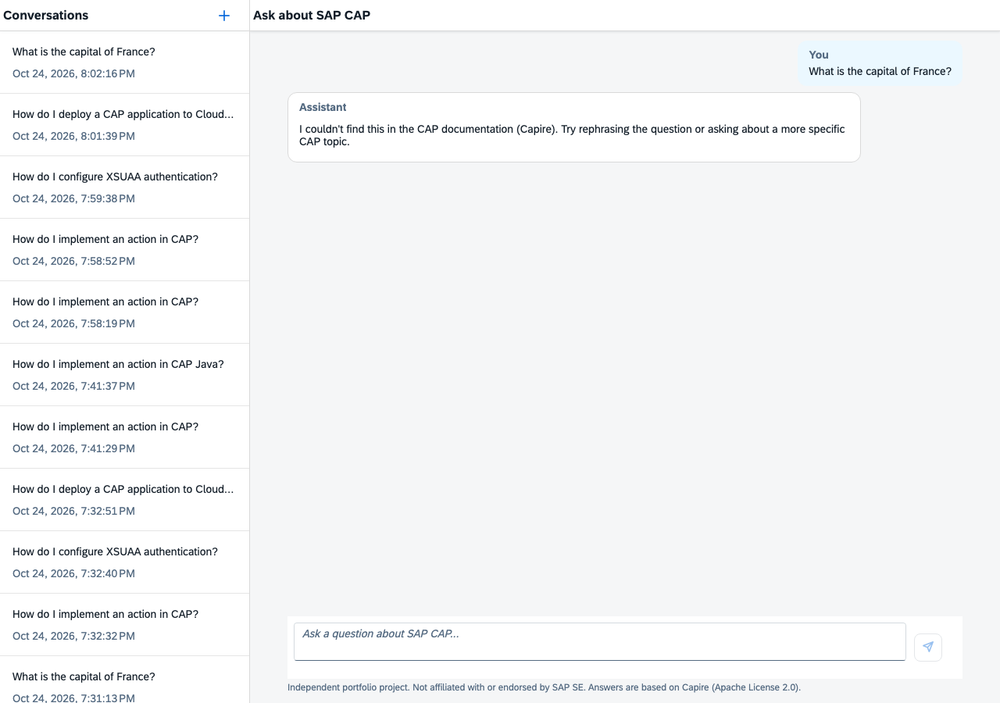
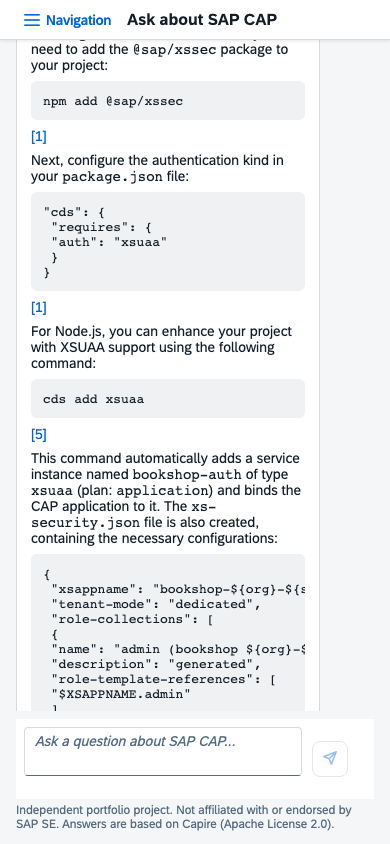
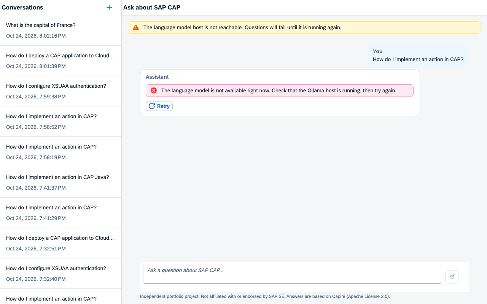

# SAP AI Knowledge Assistant

[](https://github.com/Betheval/sap-ai-knowledge-assistant/actions/workflows/ci.yml)

A retrieval-augmented assistant that answers SAP Cloud Application Programming
Model (CAP) development questions from the official CAP documentation, and shows
the sources behind every answer.

> **Independent portfolio project. Not affiliated with or endorsed by SAP SE.**

Example questions:

- How do I implement an action in SAP CAP?
- How do I configure XSUAA authentication?
- How do I deploy a CAP application to Cloud Foundry?



<p>
  
  
</p>

## Status

| Phase | Scope                                                             | Status  |
| ----- | ----------------------------------------------------------------- | ------- |
| 1     | CAP backend, CDS model, `ask` endpoint, Ollama adapter            | Done    |
| 2     | Real RAG: PostgreSQL + pgvector, ingestion, hybrid retrieval      | Done    |
| 3     | SAPUI5 / Fiori chat with sources, loading and error states        | Done    |
| 4     | Quality and production: tests, observability, Docker, CI/CD, BTP  | Planned |
| 5     | SAP AI Core instead of Ollama, behind the same internal interface | Planned |

## Architecture

```
SAPUI5 chat (TS) ──OData V4──▶ KnowledgeService (CAP, TypeScript)
                                   │  ask(conversationId?, question)
                                   ▼
                             answerQuestion (use case)
                     rewrite follow-up → retrieve → budget prompt → generate → cite
                         │                    │
                   LLMProvider            Retriever          ◀── ports
                         │                    │
                Ollama · fake · (AI Core)   pgvector + full-text (RRF) · fake  ◀── adapters
```

The use case only depends on ports; adapters are CAP services selected by
configuration, so providers can be swapped without touching the API or the UI.
Every significant decision is recorded in [`docs/adr/`](docs/adr/README.md).

## Getting started

Requirements: Node.js 22 or later.

```bash
npm install
npm run watch:fake      # fake model, in-memory SQLite: no other services needed
```

For the real setup you need, on a machine you can reach:

- [Ollama](https://ollama.com) with `qwen2.5:7b` and `bge-m3`
- PostgreSQL with pgvector (for example the `pgvector/pgvector:pg18` image),
  prepared once with `psql -U <superuser> -v app_password=<password> -f infra/postgres/setup.sql`

```bash
cp .env.example .env    # Ollama URL, database host and password
npm run db:deploy       # CDS schema + retrieval columns and indexes
npm run ingest          # download Capire, chunk, embed and store (add -- --dry-run to review first)
npm run watch
```

Open **http://localhost:4004/assistant/** for the chat UI (SAPUI5, served by
`cds-plugin-ui5` inside `cds watch`).

Development users (mocked authentication): `alice` / `alice` and `bob` / `bob`.
Each user only sees their own conversations.

### Run the production image

```bash
npm run docker:build           # or: docker build -t knowledge-assistant .
```

Create a `docker.env` file (never commit it):

```bash
CDS_ENV=standalone             # production without SAP BTP: basic authentication
OLLAMA_BASE_URL=http://<ollama-host>:11434
CDS_REQUIRES_DB_CREDENTIALS_HOST=<postgres-host>
CDS_REQUIRES_DB_CREDENTIALS_PASSWORD=<knowledge_app password>
CDS_REQUIRES_AUTH_USERS={"alice":{"password":"<choose one>","roles":["KnowledgeUser"]}}
```

```bash
docker run -p 4004:4004 --env-file docker.env knowledge-assistant
```

The image contains the compiled backend and the built UI (SAPUI5 is loaded from
the SAP CDN). The database schema is deployed beforehand with `npm run db:deploy`.
See [ADR 0018](docs/adr/0018-production-build-and-docker-image.md).

### Deploy to SAP BTP, Cloud Foundry

Every commit to `main` is tested, packaged as an MTA archive and deployed to
SAP BTP by GitHub Actions (job `deploy`, enabled with the repository variable
`BTP_DEPLOY=true`; credentials in the GitHub environment `btp`). To deploy by
hand the archive the CI built:

```bash
gh run download --name "mta-archive-$(git rev-parse HEAD)" --dir mta_archives
npm run deploy:cf                  # needs the cf CLI with the multiapps plugin
```

Assign the role collection `KnowledgeUser (knowledge-assistant <space>)` to your
user in the BTP cockpit, then open the `knowledge-assistant` route.

**The cloud deployment has no language model:** the model host is in a local
network that SAP BTP cannot reach. Login (XSUAA), UI, authorization and a sample
history are real; every question answers that the language model is unavailable,
which is the designed behavior without a model. Answering questions is shown
locally. See [ADR 0019](docs/adr/0019-deployment-to-sap-btp-cloud-foundry.md) and
"AI in the cloud" below.

### Try it from the command line

```bash
curl -u alice:alice -X POST http://localhost:4004/odata/v4/knowledge/ask \
  -H 'content-type: application/json' \
  -d '{"question":"How do I implement an action in CAP?"}'
```

Pass the returned `conversationId` to ask follow-up questions. History is
available at `/odata/v4/knowledge/Conversations?$expand=messages($expand=sources)`.

| Endpoint              | Purpose                                                |
| --------------------- | ------------------------------------------------------ |
| `/odata/v4/knowledge` | OData V4 service: `ask` action, conversation history   |
| `/health`             | Liveness of the application                            |
| `/health/llm`         | Model host reachable, model pulled, running on the GPU |

## AI in the cloud

The use case depends on ports, not on Ollama
([ADR 0003](docs/adr/0003-provider-abstraction-via-cap-services.md)), so the
cloud deployment can get models in two ways without changing the API, the UI or
the RAG logic.

**Today: local models, cloud without a model**

```
Laptop / local network                      SAP BTP (trial)
┌───────────────────────────────┐           ┌──────────────────────────────────┐
│ CAP + UI (npm run watch)      │           │ Approuter (XSUAA) → CAP service  │
│   ├─ Ollama (qwen2.5, bge-m3) │           │   in-memory SQLite, demo history │
│   └─ PostgreSQL + pgvector    │           │   no model → model unavailable   │
└───────────────────────────────┘           └──────────────────────────────────┘
```

**Option A: SAP AI Core (generative AI hub)**: managed models on SAP BTP.

```
Browser → Approuter (XSUAA) → CAP service ──→ SAP AI Core: chat model + embedding model
                                   └──────→ PostgreSQL on SAP BTP (pgvector, Capire ingested)
```

- New adapters for `LLMProvider` and `EmbeddingProvider`, e.g. with the SAP Cloud
  SDK for AI; configuration selects them per profile.
- A different embedding model means re-ingesting Capire
  ([ADR 0005](docs/adr/0005-bge-m3-embeddings-and-reindexing.md)); the golden set
  compares retrieval and answer quality with the local models.
- Fully managed and always available. **Not part of the free trial**: SAP AI Core
  is a paid service.

**Option B: SAP Cloud Connector in front of the local Ollama**: hybrid set-up.

```
Browser → Approuter (XSUAA) → CAP service ──→ PostgreSQL on SAP BTP (pgvector)
                                   │
                                   └─→ Connectivity service ⇄ Cloud Connector ⇄ Ollama
                                       (SAP BTP)       (outbound TLS tunnel from the local network)
```

- The Cloud Connector runs on the local host and opens an outbound, encrypted
  tunnel to SAP BTP: no inbound port and no public exposure of Ollama.
- The Ollama adapters call the model through the connectivity service proxy
  instead of a direct URL; models, embeddings and data stay as they are.
- Free (Cloud Connector, connectivity and PostgreSQL trial), and the standard SAP
  pattern to connect cloud apps with on-premise systems. Answers are only
  available while the local host is running.

Both options add back the PostgreSQL service and the schema deployer module,
which the build already prepares.

## Scripts

| Script                   | Description                                                 |
| ------------------------ | ----------------------------------------------------------- |
| `npm run watch`          | Development server: Ollama and PostgreSQL                   |
| `npm run watch:fake`     | Development server: fake LLM, SQLite                        |
| `npm run watch:trace`    | Development server with OpenTelemetry traces in the console |
| `npm run db:deploy`      | Deploy the schema to PostgreSQL                             |
| `npm run ingest`         | Ingest Capire into the knowledge base                       |
| `npm run eval:retrieval` | Retrieval metrics on the golden set                         |
| `npm run build`          | Production build (backend, UI, credentials check)           |
| `npm run docker:build`   | Production Docker image                                     |
| `npm test`               | Unit and service tests (no network required)                |
| `npm run typecheck`      | TypeScript type check                                       |
| `npm run lint`           | ESLint (TypeScript and CDS)                                 |
| `npm run format`         | Prettier                                                    |

## Documentation corpus and attribution

Answers are grounded in [Capire](https://cap.cloud.sap/docs/), the CAP
documentation, whose sources are published at
[github.com/cap-js/docs](https://github.com/cap-js/docs) under the
[Apache License 2.0](https://github.com/cap-js/docs/blob/main/LICENSE),
© SAP SE or an SAP affiliate company and cap-js/docs contributors. The
documentation is not copied into this repository; every answer links to the
original pages. See [ADR 0009](docs/adr/0009-capire-as-corpus.md).

SAP and other SAP products mentioned are trademarks or registered trademarks of
SAP SE in Germany and other countries.

## License

[Apache License 2.0](LICENSE)
